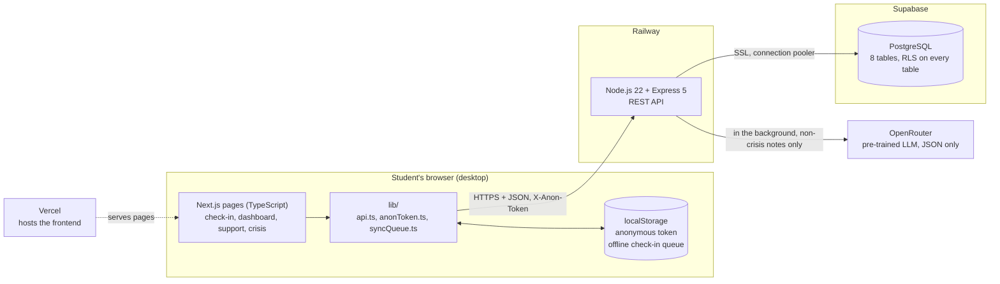
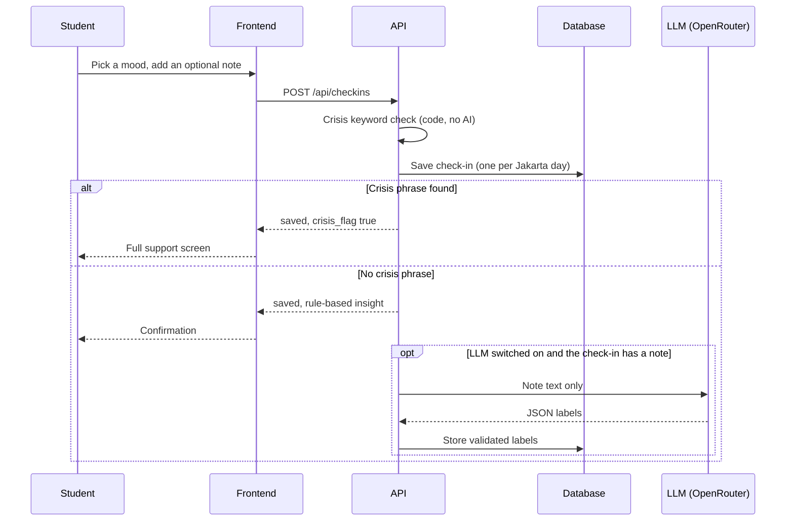
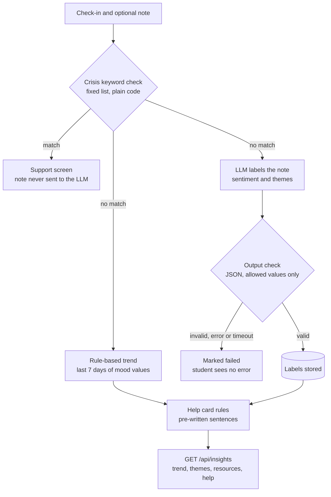
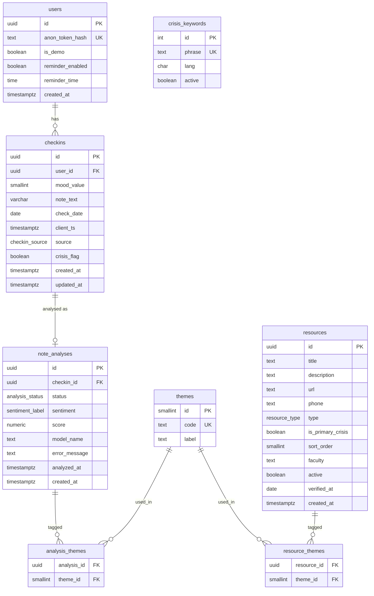

# MindMeter architecture

System design, database and AI pipeline as built. The code is the source of truth. Details of each endpoint are in [API-CONTRACT.md](./API-CONTRACT.md).

## 1. System overview

| Part | Technology | Status |
|------|------------|--------|
| Frontend | Next.js + TypeScript | In `frontend/`, not deployed yet |
| API | Node.js + Express (JavaScript) | In `backend/`, not deployed yet |
| Database | Supabase PostgreSQL | Created, schema and safety data loaded |
| LLM | OpenRouter | Code ready, off until a key and model are set |

The browser only ever talks to the API. It never connects to the database and never holds the OpenRouter key. The types shared by both sides are in [`shared/contract.ts`](../shared/contract.ts), and the integration tests check every API response against them.

### Why these hosts
The department Azure account was the original target and was not confirmed. Vercel, Railway and Supabase are the replacement. The app reads all settings from environment variables, so moving to Azure later needs configuration, not a rewrite.

### Networking features
- REST over HTTPS with CORS limited to the frontend address
- Rate limit of 60 requests a minute per IP (`429 RATE_LIMITED`). The public support list is never limited
- Offline queue in the browser with an idempotent `POST /api/checkins/sync`
- One log line per request with a request id, status and latency, never the note or token

## 2. Check-in flow

If the request cannot reach the server, the frontend keeps the check-in in its offline queue and sends it later.

## 3. AI pipeline

MindMeter uses two kinds of AI, with a safety check in front of both. No model is trained.

### 3.1 Safety check (not AI)
`logic/crisisCheck.js` matches whole phrases in English and Indonesian from the reviewed keyword list. It runs before anything else and cannot be overridden by the LLM.

Limit: it matches listed phrases only, so indirect wording can be missed. This is why the support button is always visible.

### 3.2 Rule-based trend (`logic/trendRules.js`)
Explainable rules on the last 7 days:

| Rule | Value |
|------|-------|
| Fewer than 3 check-ins | "Stable", ask for more data |
| Low day | Mood 1 or 2 |
| 3 low days in a row | Declining, support suggested |
| 7-day average 2.5 or below | Support suggested |
| Change between the two halves of the window of 0.75 or more | Declining or improving |

### 3.3 LLM labels (`services/nlpService.js`)
The note is sent alone, with no user id, to a pre-trained model through OpenRouter. The prompt asks for JSON only and says the note is data, not instructions. The model returns a sentiment (positive, neutral, negative), a confidence score and up to 3 themes from a fixed list of 8: sleep, workload, exams, isolation, relationships, finance, health, motivation.

It runs after the response is sent, with temperature 0 and a 15 second timeout, so a slow model never delays a check-in.

### 3.4 Output guardrail
- Only the sentiment, score and themes are read. Any other field, such as invented advice, is dropped
- Themes outside the fixed list are removed
- Broken JSON, a missing or unknown sentiment, an HTTP error or a timeout mark the analysis `failed`
- The note is never written to logs

### 3.5 Help card (`logic/helpRules.js`)
The LLM never writes text a student sees. Fixed rules pick pre-written sentences:

| Input | Result |
|-------|--------|
| Crisis check-in in the last 14 days | Reach-out message, crisis contacts first |
| Most frequent theme in 14 days | A short tip for that theme |
| Low trend, or 3 or more negative notes in 14 days | Direct suggestion to book a counsellor |
| Otherwise | Gentle booking pointer |
| No counselling contacts available | Points to the Support page |

The booking list includes UGM-wide and faculty counselling services. The faculty is chosen in the browser and never sent to the API.

The API returns the help card. The dashboard does not show it yet.

### 3.6 Evidence
| Claim | Test |
|-------|------|
| Crisis notes never reach the LLM | `tests/unit/services.test.js`, `tests/integration/api.test.js` |
| Bad model output is dropped | `nlpService guardrails` in `services.test.js` |
| Every listed crisis phrase triggers | `tests/unit/safetyData.test.js` |
| Works with the LLM switched off | failure drill in `api.test.js` |
| Help card rules | `tests/unit/helpRules.test.js` |

`npm run eval:nlp` runs the real model on 20 invented notes (10 English, 10 Indonesian) and reports accuracy and latency. It has not been run yet because no model is configured.

## 4. Database (ERD)

Source: [`backend/src/models/schema.sql`](../backend/src/models/schema.sql). This diagram replaces the older images in `docs/image/`.

- One check-in per user per day (`unique (user_id, check_date)`)
- No names, emails or other personal details. The browser token is stored only as a SHA-256 hash
- `crisis_keywords` stands alone and is read by the crisis check
- Row level security is on for every table with no policies, so Supabase's public API reads nothing. The API connects as the table owner
